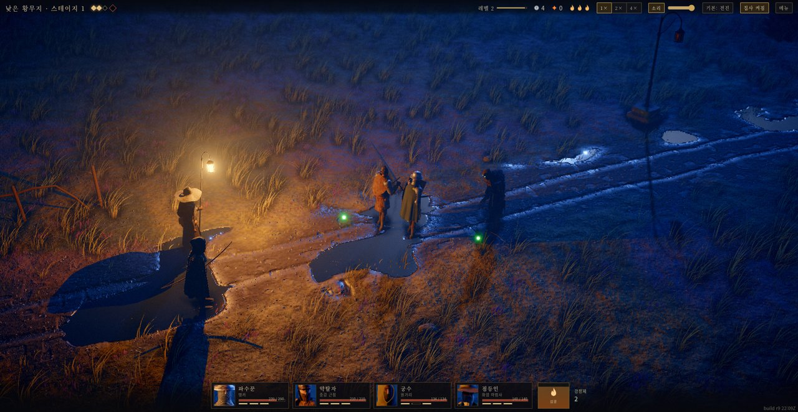
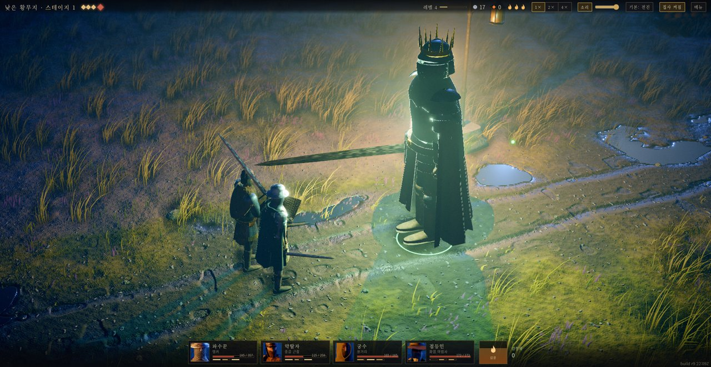
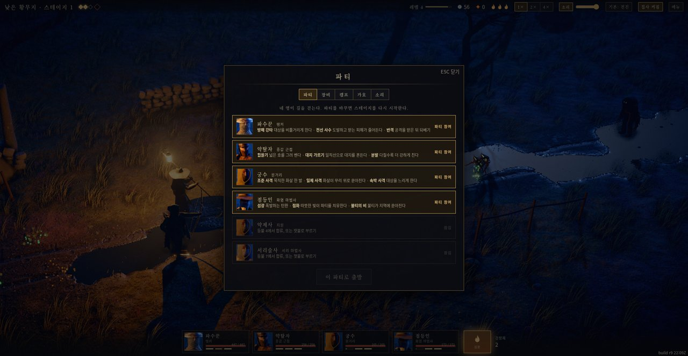

# LANTERNFALL 한글화 (비공식)

원작: **[LANTERNFALL](https://github.com/loktar00/lanternfall)** by [loktar00](https://github.com/loktar00)
원작 플레이: https://loktar00.github.io/lanternfall/

이 저장소는 원작자가 만든 공식 한글화가 **아닙니다**. 원작 게임을 한국어로 옮긴 비공식 팬 한글화입니다.
원작 저장소에는 라이선스가 명시되어 있지 않으며, 원 저작권자의 권리는 그대로 유지됩니다.
원 저작권자가 문제를 제기하면 이 공개본은 내려갈 수 있습니다.

## 소개

LANTERNFALL은 어둠 속 황무지를 랜턴 불빛 하나에 의지해 지나가는 3D 자동 전투 RPG입니다.
영웅 파티가 웨이브로 몰려오는 적과 자동으로 싸우고, 플레이어는 랜턴의 섬광과 파티 구성,
장비·가호 선택으로 전투의 흐름을 바꿉니다. 이 저장소는 그 게임의 표시 문자열 전체를
한국어로 옮긴 비공식 한글화본입니다.

## 주요 기능

- 3D 자동 전투: 영웅들이 쿨다운마다 스킬을 쓰며 웨이브를 격파합니다
- 랜턴 섬광: 위기의 웨이브에서 전장을 밝혀 파티를 강화하는 핵심 자원
- 파티·장비·캠프·가호 관리: 영웅 6종, 장비와 유물, 카드 31장으로 빌드를 구성
- 지역·스테이지 진행과 보스전, 클로즈업 카메라 연출
- 게임 속도 1x / 2x / 4x 전환, 소리 디버그 오버레이(F8)
- 게임 내 표시 문자열 전체 한국어화 (게임 타이틀과 빌드 표기는 원형 유지)

## 실행 화면







## 플레이

공개 플레이: https://sigco3111.github.io/lanternfall-ko/ (GitHub Pages)

`index.html` 하나로 동작하는 단일 페이지 게임입니다. 브라우저로 열면 바로 플레이할 수 있습니다.

- Enter / Space (또는 클릭): 타이틀 화면에서 시작
- 전투는 자동으로 진행되고, 영웅들은 쿨다운마다 스킬을 사용합니다
- Space: 랜턴 섬광 (위기의 웨이브에서 전장을 밝히고 파티를 강화)
- M: 메뉴 (파티/장비/캠프/가호/소리) · Esc: 패널 닫기 · C: 클로즈업 카메라
- `+` / `-`: 게임 속도 (1x, 2x, 4x) · F8: 소리 디버그 오버레이
- 소리는 페이지를 한 번 클릭해야 켜집니다 (브라우저 오디오 정책)

## 설치와 실행

- 브라우저에서 바로 플레이: https://sigco3111.github.io/lanternfall-ko/
- 로컬에서 실행: 저장소를 내려받아 `index.html`을 브라우저로 열면 됩니다. 별도의 설치 과정은 없습니다.

```sh
git clone https://github.com/sigco3111/lanternfall-ko.git
cd lanternfall-ko
# index.html을 브라우저로 열기
```

## 한글화 범위

영웅·몬스터·보스 이름, 스킬, 카드 31장, 장비/유물, 캠프/가호, 지역 이름, HUD, 메뉴 전체,
타이틀/결과 화면, 토스트와 전투 플로팅 텍스트까지 게임 내 표시 문자열 전체를 한국어로 옮겼습니다.
게임 타이틀(LANTERNFALL)과 빌드 표기는 원형을 유지했습니다.

## 빌드

```sh
sh tools/build.sh          # index.html 생성
sh tools/build.sh stage    # stage.html 생성
```

`python`과 `node`가 필요합니다. `three.min.js`와 `src/*.js`를 `src/head.html` 템플릿에 합쳐
하나의 페이지를 만듭니다. 한글 문자열은 빌드 시 `tools/ascii.py`가 `\uXXXX` 이스케이프로 변환합니다.

## 크레딧

- 원작 게임: loktar00 (저작권은 원 저작권자에게 있습니다)
- 3D 엔진: [three.js](https://threejs.org/) (MIT)
- 한글화: Instinct (비공식)
